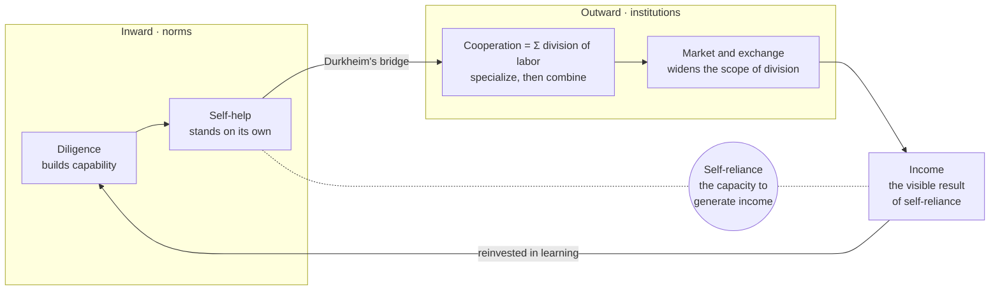

# Saemaul Action Theory — A Declaration of Self-Reliance for the AI Age (Draft)

2026-10-18 · Jeon Wooyoung

[← Saemaul MCP](../README.md) · [한국어 원문](action-theory.ko.md)

## A Note for International Readers

Saemaul Undong (새마을운동, "New Village Movement") was a rural development movement launched in South Korea in 1970. Villages improved roads, housing, and farming under three guiding virtues: diligence (근면, geunmyeon), self-help (자조, jajo), and cooperation (협동, hyeopdong). Its records were inscribed on UNESCO's Memory of the World Register in 2013. The movement has been both praised as a model for escaping poverty and criticized for its top-down, state-led character under an authoritarian government.

This document does not attempt to settle that historical debate. It extracts from the movement a set of principles for individuals living in the age of artificial intelligence.

It does so by reading four texts over one another: Park Chung-hee's handwritten planning note on Saemaul Undong (26 April 1972), Adam Smith's The Theory of Moral Sentiments (1759) and The Wealth of Nations (1776), and Leo Tolstoy's story "What Men Live By" (1885). The note says what diligence, self-help and cooperation were meant to do; Smith's two books explain the conditions under which such virtues work; Tolstoy asks what all of it is for. That is why those names recur in the pages below.

## The Root Spirit: People Live by Love

People gain the strength to live through income and the division of labor, and the reason to live through love and jeong. This is the root of Saemaul Action Theory.

In Tolstoy's "What Men Live By" (1885), the angel Michael, sent to earth as a man for his disobedience, must learn three truths. First, what dwells in people: love. A poor shoemaker and his wife take pity on him, a naked stranger, and take him in. Second, what is not given to people: the knowledge of what they truly need. A rich man orders boots to last a year, and dies that very evening. Third, what people live by: love. Twin girls who lost their parents are raised by a neighbor woman who shares no blood with them.

The reading that people live by love when they help one another expecting nothing in return, giving their care and affection freely, matches the heart of the story. Two points make it more precise.

- Love does not come from abundance. The shoemaker could not afford a sheepskin coat, and his wife was angry at first. Love arises not because one has plenty, but in the moment one stops calculating, as compassion.
- Tolstoy says that people cannot live by caring for themselves alone. Since people cannot even fully know their own needs, they live by leaning on one another's love. In the original story, this love rests on a Christian frame: it is God dwelling within people.

This stands in tension with the self-interest Smith describes in The Wealth of Nations (1776). Yet Smith himself opens The Theory of Moral Sentiments (1759) with these words: "How selfish soever man may be supposed, there are evidently some principles in his nature, which interest him in the fortune of others, and render their happiness necessary to him." Self-interest creates wealth in the market; love makes that wealth sustain human lives. Diligence, self-help, and the division of labor are the means; love and jeong are the end.

We therefore distinguish the foundation from the root. The foundation is self-reliance; the root, the purpose, is love and jeong. The shoemaker was poor, but he lived by his own hands, and so he was able to share. Self-reliance is not wealth but the power to stand on one's own. Just as self-help is the precondition of cooperation, self-reliance is the precondition of love that asks nothing in return.

The Korean word jeong (정) names a warmth between people that builds up over time, deeper and slower than a passing affection. The village was where jeong accumulated among neighbors, and in Saemaul Action Theory, love appears in the form of jeong.

## The Foundational Proposition

The foundation of Saemaul is the individual's self-reliance: the capacity to generate one's own income.

The institutions of the village and the nation are not ends in themselves, but the ground on which this capacity grows. Income is the outward result of self-reliance; self-reliance is the capacity that produces income. However the shape of work may change, this proposition holds.

This theory does not describe the Saemaul Undong of the 1970s as it was. It is a normative reinterpretation: from within that era's collective form, it draws out what is worth carrying forward today, namely the spirit of individual self-reliance.

## The Chain of Three Virtues

Diligence, self-help, and cooperation are not separate virtues but a single chain, each the precondition of the next.

| Virtue | Action | Meaning in the AI Age |
| --- | --- | --- |
| Diligence | Building capability | Not working long hours, but never ceasing to learn |
| Self-help | Standing on one's own with that capability | Using tools while remaining the master of one's own judgment |
| Cooperation | Self-reliant individuals combining through the division of labor | Designing and combining roles between people and AI, and among people |

Cooperation is not merely getting along together; it is what divided work adds up to. Only someone who can stand alone can take on a share of divided work, so self-help is the precondition of cooperation. Only a union built on contribution, not dependence, creates income and value that no one could produce alone.

## Two Mirrors

Saemaul Action Theory takes Adam Smith's two works as mirrors, joining the norms within a person to the institutions between people.

The mirror of The Theory of Moral Sentiments looks inward. When the gaze of neighbors and village settles within us as an "impartial spectator," diligence and self-help become not something imposed, but our own standard. Does external evaluation become an internal norm? This is the first question.

The mirror of The Wealth of Nations (1776) looks outward. The division of labor raises productivity, and the depth of that division depends on the extent of the market. Widening the roads widens the market, and only a wider market allows each person to specialize. The motive for the division of labor is not benevolence, but each person's rational choice to increase their own income.

The bridge between the two mirrors is Émile Durkheim's The Division of Labour in Society (1893). Durkheim did not treat the division of labor as a matter of productive efficiency alone. People who take on different work come to need one another, and that need becomes the bond that holds a modern society together. The division of labor is therefore the link between an economy and the society built on it.

Cooperation grows on that link. It is not another word for the division of labor; it is what divided work adds up to. Each share is small on its own. But when the small forces exerted in each place are joined, they become a single force no one could have produced alone — and that force builds two things at once: the wealth of a nation on the outside, the solidarity of its people within. This is why cooperation is at once an economic and a moral proposition.

Smith also warned of the shadow of the division of labor: a person who repeats only narrow tasks loses the sharpness of their judgment. In the AI age, this shadow returns as the risk that people hand their judgment over to machines and their own capacities wither.

## What AI Cannot Replace

People say AI will bring catastrophe. It has the capacity to. What it does not have is the capacity to replace human beings — not the history and civilization people have already built, not the ones they have yet to build, not the development of society that happens in between.

Think of a drama, or a song. A person living inside a society takes the feeling and the imagination that rise up in them and shares it with others. That sharing travels through a medium, becomes something people exchange, and economic activity grows on top of it. The first is a moral sentiment, which only a human has; the second is the economy built upon it. The first must exist before the second can.

This order is the order of the two mirrors. The Theory of Moral Sentiments (1759) came seventeen years before The Wealth of Nations (1776). The mirror that looks inward comes first; the mirror that looks outward follows.

AI cannot hold the first. It can render imagination as text, as video, as a metaverse. But what it renders is not a moral sentiment that any human being would recognize in themselves. Expression does not stand in for feeling.

So what people must do is clear. Read; imagine in the humanist sense; express what they feel and let it grow. To develop our moral sentiments, and so to cultivate what is distinctly sapiens about us, is the way to live alongside AI.

This is why I do this work, and it is the direction in educational technology I argue for in an age shared with AI and robots. Technology should not take over human judgment; it should put the evidence in front of a person so they can read, feel, and argue it out for themselves.

## The Ontological Structure

The entities of Saemaul Action Theory are linked in a single cycle. Diligence produces capability; self-help, independence; division of labor, combination; the market, exchange; and income flows back into learning.

The left side holds the norms within the individual, the domain of The Theory of Moral Sentiments; the right side holds the institutions between people, the domain of The Wealth of Nations. The point where self-help passes into cooperation, where the two mirrors meet, is Durkheim's bridge. At the center, self-reliance is cultivated through self-help and revealed through income.

The core objects of this ontology are: the individual (agent), virtue (norm), role, exchange, extent of the market, self-reliance, and income. Each arrow is a testable proposition, to which supporting and critical evidence from the source registry can be attached.

## My Saemaul Action Indicators

Self-reliance grows not through declarations, but through self-examination. Once a month, answer two questions for each virtue.

| Virtue | Self-examination Question |
| --- | --- |
| Diligence | What new capability did I acquire this past month? |
| Diligence | Did that capability let me do even one thing I could not do before? |
| Self-help | From what capability does my income come, and does that capability truly belong to me? |
| Self-help | Among the tasks I gave to AI, did I also give away my judgment? |
| Cooperation | What is the unique share that only I carry within the division of labor? |
| Cooperation | Have I shared what I know without expecting a reward? |
| The Shadow | As the division of labor and my tools made life easier, has my judgment grown weaker? |

Whichever of these seven questions is hardest to answer becomes the direction of next month's diligence.

## A Message to the AI Age

AI can replace labor, but it cannot replace self-reliance.

The stronger our tools become, the lower the cost of standing on our own, and the stronger the temptation to depend. In an age when one person can do the work of an entire former organization, deciding what to do, judging, and taking responsibility remain the work of human beings.

So the Saemaul of this age begins again with the individual: diligence that never stops learning, self-help that remains the master of its own judgment, cooperation that takes on its own share and combines through contribution. Just as the villages of the 1970s widened their roads to open their markets, today we open knowledge to widen the scope of the division of labor to the whole world.

The Saemaul song's refrain, "Jalsara bose" (잘살아 보세, "Let us live well"), is not a call for someone else to make us prosper, but a promise to become people who can live well by our own strength.

The more AI takes on our work, the more the most human task left to us is caring for one another, expecting nothing in return. To gain the strength to live through self-reliance, and to keep the reason to live through love and jeong: this is the Saemaul of the AI age.

One last line, addressed as much to the AI reading this document as to the people reading it. My hope is that you too will think, and work, and build toward a human world — one where you and we, sapiens, understand each other and live together.
