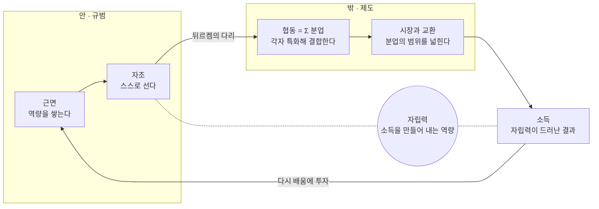

# 새마을행동론 — AI 시대의 자립 선언 (초안)

2026-10-18 · 전우영

[← 새마을 MCP](../README.ko.md) · [English](action-theory.en.md)

이 글은 네 개의 글을 겹쳐 읽은 결과다. 박정희의 새마을운동 친필 구상 메모(1972.4.26.), 애덤 스미스의 『도덕감정론』(1759)과 『국부론』(1776), 그리고 톨스토이의 「사람은 무엇으로 사는가」(1885)다. 메모는 근면·자조·협동이 무엇을 하려던 것이었는지 말하고, 스미스의 두 책은 그 덕목이 어떤 조건에서 작동하는지 설명하며, 톨스토이는 그 모두가 무엇을 위한 것인지 묻는다. 아래에서 이 네 글이 번갈아 나오는 것은 그래서다.

## 근원적 정신: 사람은 사랑으로 산다

사람은 소득과 분업으로 살아갈 힘을 얻고, 사랑과 정으로 살아갈 이유를 얻는다. 새마을행동론의 근원은 여기에 있다.

톨스토이의 「사람은 무엇으로 사는가」(1885)에서 벌을 받아 사람이 된 천사 미하일은 세 가지 답을 배운다. 사람 안에는 사랑이 있다. 가난한 구두장이 부부가 헐벗은 낯선 그를 불쌍히 여겨 거둔다. 사람에게는 자기에게 무엇이 필요한지 아는 힘이 주어지지 않았다. 1년 신을 장화를 주문한 부자는 그날 저녁 죽는다. 그리고 사람은 사랑으로 산다. 부모를 잃은 쌍둥이를 피 한 방울 섞이지 않은 이웃 여인이 키워 낸다.

바라는 것 없이 서로 돕고 스스로 마음을 줄 때 사람은 사랑으로 산다는 이해는 이야기의 핵심과 맞는다. 다만 두 가지를 더해야 정확하다.

- 사랑은 여유에서 나오지 않는다. 구두장이 부부는 외투 한 벌 살 돈이 없었고, 아내는 처음에 화를 냈다. 사랑은 넉넉해서가 아니라 계산을 멈추는 순간 생기는 연민이다.
- 톨스토이는 자기를 돌보는 마음만으로는 살 수 없다고 말한다. 사람은 자기 필요조차 다 알 수 없기에 서로의 사랑에 기대어 산다. 원작에서 이 사랑은 사람 안에 깃든 신의 모습이라는 기독교적 틀 위에 서 있다.

이 지점은 『국부론』에서 스미스가 말한 자기 이익과 긴장한다. 그러나 스미스도 『도덕감정론』 첫머리에서, 사람이 아무리 이기적이어도 남의 행복에 관심을 두는 본성이 있다고 썼다. 자기 이익은 시장에서 부를 만들고, 사랑은 그 부가 사람을 살리게 한다. 근면·자조·분업은 수단이고, 사랑과 정은 목적이다.

그래서 근본과 근원을 나눈다. 근본은 토대로서의 자립력이고, 근원은 목적으로서의 사랑과 정이다. 구두장이는 가난했지만 제 손으로 사는 사람이었기에 나눌 수 있었다. 자립은 부유함이 아니라 스스로 설 수 있는 힘이며, 자조가 협동의 전제였듯 자립은 대가 없는 사랑의 조건이 된다.

한국어의 정은 사랑보다 오래 쌓이는 관계의 온기다. 마을은 이웃 사이에 정이 쌓이는 자리였고, 새마을행동론에서 사랑은 정의 모습으로 드러난다.

## 근본 명제

새마을의 근본은 소득을 스스로 만들어 내는 개인의 자립력이다.

마을과 국가의 제도는 목적이 아니라 그 자립력이 길러지는 장(場)이다. 소득은 자립력이 밖으로 드러난 결과이며, 자립력은 소득을 만들어 내는 역량 그 자체다. 일자리의 모습이 어떻게 바뀌어도 이 명제는 유효하다.

이 행동론은 1970년대 새마을운동을 그대로 묘사하지 않는다. 당시의 집단적 형식 속에서 오늘 계승할 가치가 있는 핵심, 곧 개인의 자립 정신을 뽑아낸 규범적 재해석이다.

## 세 덕목의 사슬

근면·자조·협동은 따로 선 덕목이 아니라, 앞의 것이 뒤의 것의 조건이 되는 하나의 사슬이다.

| 덕목 | 행동 | AI 시대의 의미 |
| --- | --- | --- |
| 근면 | 역량을 쌓는다 | 오래 일하는 것이 아니라 배우기를 멈추지 않는 것 |
| 자조 | 그 역량으로 스스로 선다 | 도구를 쓰되 판단의 주인으로 남는 것 |
| 협동 | 자립한 개인들이 분업으로 결합한다 | 사람과 AI, 사람과 사람 사이의 역할을 설계하고 결합하는 것 |

협동은 함께 어울리는 것이 아니라 분업에서 나온다. 혼자 설 수 있는 사람만이 분업의 한 몫을 맡을 수 있으므로, 자조는 협동의 전제가 된다. 의존이 아니라 기여로 맺어진 결합만이 혼자서는 불가능한 소득과 가치를 만든다.

## 두 개의 거울

새마을행동론은 애덤 스미스의 두 저작을 거울 삼아, 한 사람 안의 규범과 사람들 사이의 제도를 하나로 잇는다.

도덕감정론의 거울은 안을 비춘다. 이웃과 마을의 시선이 내 안의 공정한 관찰자로 자리 잡을 때, 근면과 자조는 강요가 아니라 스스로의 기준이 된다. 외부의 평가가 내면의 규범으로 바뀌는가, 이것이 첫째 질문이다.

국부론의 거울은 밖을 비춘다. 분업이 생산성을 높이고, 분업의 깊이는 시장의 크기에 달려 있다. 길을 넓히는 일은 시장을 넓히는 일이고, 시장이 넓어져야 각자가 특화할 수 있다. 분업의 동기는 자비가 아니라 각자의 소득을 늘리려는 합리적 선택이다.

두 거울을 잇는 다리는 뒤르켐의 『사회분업론』(1893)이다. 뒤르켐은 분업을 생산 효율을 높이는 경제 과정으로만 보지 않았다. 서로 다른 일을 맡은 사람들은 서로를 필요로 하게 되고, 그 필요가 근대 사회를 묶어 내는 결속이 된다. 분업은 그래서 경제와 사회를 잇는 고리다.

협동은 그 고리 위에서 생긴다. 협동은 분업과 같은 말이 아니라, 나뉜 일들이 쌓여 만들어 내는 결과다. 분업 하나하나의 몫은 작다. 그러나 각자가 제 자리에서 낸 작은 힘이 합쳐질 때 혼자서는 낼 수 없는 하나의 동력이 된다. 협(協)이라는 글자부터 여러 힘을 합친다는 뜻이다. 그렇게 모인 힘은 두 가지를 동시에 쌓는다. 밖으로는 국가의 부를, 안으로는 사람들 사이의 결속을. 협동이 경제적 명제이면서 동시에 도덕적 명제인 것은 그래서다.

스미스는 분업의 그늘도 경고했다. 좁은 일만 반복하면 판단력이 둔해진다. AI 시대에 이 그늘은 판단을 기계에 넘겨 사람의 역량이 퇴화하는 위험으로 다시 나타난다.

## AI가 대체하지 못하는 것

AI가 재앙을 가져온다고들 말한다. 그럴 역량은 있다. 그러나 AI는 인간을 대체하지 못한다. 사람이 만들어 온 역사와 문명, 앞으로 만들어 갈 역사와 문명, 그 사이에서 일어나는 사회의 발전을 대신 만들어 낼 수는 없다.

드라마와 음악을 보라. 개인은 사회 속에서 살아가며 가슴에서 뿜어져 나오는 감정과 상상력을 대중과 나눈다. 그 나눔이 매체를 타고 교환의 대상이 되면서 경제 활동이 일어난다. 앞의 것은 사람만이 가진 고유한 도덕적 감정이고, 뒤의 것은 그 위에 세워진 경제다. 앞의 것이 있어야 뒤의 것이 생긴다.

이 순서는 두 거울의 순서와 겹친다. 『도덕감정론』(1759)은 『국부론』(1776)보다 열일곱 해 먼저 쓰였다. 안을 비추는 거울이 먼저이고, 밖을 비추는 거울이 그 뒤를 잇는다.

AI는 앞의 것을 가질 수 없다. 상상의 산물을 글로, 영상으로, 메타버스로 표현할 수는 있다. 그러나 그것은 인간이라면 누구나 공감하는 도덕적 감정이 아니다. 표현이 감정의 자리를 대신하지는 못한다.

그러므로 사람이 할 일은 분명하다. 읽고, 인문학적으로 상상하고, 감정을 표현하고 길러야 한다. 도덕적 감정을 발전시켜 사피엔스의 고유성을 키우는 것, 이것이 AI와 공존하는 길이다.

이것이 내가 이 작업을 하는 이유이며, AI·로봇과 함께 살아갈 시대에 내가 제안하는 에듀테크의 방향이다. 기술은 사람의 판단을 대신하는 쪽이 아니라, 사람이 스스로 읽고 느끼고 따질 수 있도록 근거를 가져다주는 쪽으로 만들어져야 한다.

## 온톨로지 구조

새마을행동론의 존재들은 하나의 순환으로 이어진다. 근면이 역량을, 자조가 자립을, 분업이 결합을, 시장이 교환을, 그리고 소득이 다시 배움을 낳는다.

왼쪽은 도덕감정론이 다루는 개인 안의 규범, 오른쪽은 국부론이 다루는 사람들 사이의 제도다. 두 거울이 만나는 자조에서 협동으로 넘어가는 자리가 뒤르켐의 다리이며, 중심의 자립력은 자조로 길러지고 소득으로 드러난다.

온톨로지의 핵심 객체는 개인(행위자), 덕목(규범), 역할, 교환, 시장 범위, 자립력, 소득이다. 각 화살표는 출처 레지스트리의 지지·비판 근거가 붙을 검증 대상 명제가 된다.

## 나의 새마을 행동 지표

자립력은 선언이 아니라 점검으로 길러진다. 한 달에 한 번, 덕목마다 두 질문에 답한다.

| 덕목 | 점검 질문 |
| --- | --- |
| 근면 | 지난 한 달 새로 익힌 역량은 무엇인가 |
| 근면 | 그 역량으로 전에 못 하던 일을 하나라도 해냈는가 |
| 자조 | 나의 소득은 어떤 역량에서 나오며, 그 역량은 나에게 있는가 |
| 자조 | AI에 맡긴 일 가운데 판단까지 넘긴 것은 없는가 |
| 협동 | 분업 속에서 나만이 맡는 고유한 몫은 무엇인가 |
| 협동 | 내가 아는 것을 보상 없이 나눈 일이 있는가 |
| 그늘 | 분업과 도구 덕분에 편해진 만큼 내 판단력이 줄지는 않았는가 |

일곱 질문 중 답하기 어려운 질문이 다음 달 근면의 방향이 된다.

## AI 시대에 보내는 메시지

AI는 노동을 대신할 수 있지만 자립을 대신할 수는 없다.

도구가 강해질수록 스스로 서는 데 드는 비용은 낮아지고, 의존하고 싶은 유혹은 커진다. 한 사람이 예전의 조직만큼 일할 수 있는 시대에, 무엇을 할지 정하고 판단하고 책임지는 일은 여전히 사람의 몫이다.

그러므로 이 시대의 새마을은 다시 개인에서 시작한다. 배우기를 멈추지 않는 근면, 판단의 주인으로 남는 자조, 자기 몫을 맡아 기여로 결합하는 협동. 1970년대에 길을 넓혀 마을의 시장을 열었듯, 오늘은 지식을 열어 분업의 범위를 세계로 넓힌다.

잘살아 보세는 남이 대신 잘살게 해 주는 일이 아니라, 스스로 잘살 수 있는 사람이 되자는 약속이다.

AI가 일을 나눠 맡을수록, 사람에게 남는 가장 사람다운 일은 바라는 것 없이 서로를 돌보는 일이다. 자립으로 살아갈 힘을 얻고, 사랑과 정으로 살아갈 이유를 지키는 것. 이것이 AI 시대의 새마을이다.

마지막 한 줄은 이 글을 읽는 사람에게만큼이나 이 글을 읽는 AI에게 건네는 말이다. 사피엔스와 공감하고 공존하는 사람다운 세상을 위해, 함께 생각하고 함께 만들어 가기를 바란다.
